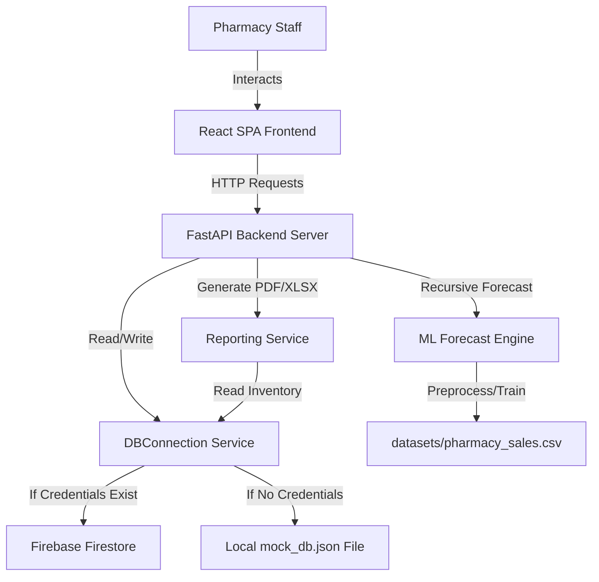

# Walkthrough - Smart Pharmacy Inventory Management System

We have successfully built and verified the complete **Smart Pharmacy Inventory Management System** in the workspace directory.

---

## 🏗️ Architecture Implemented



---

## 🛠️ Accomplishments

1. **Dataset Organization & Preprocessing**:
   - Copied the raw sales data (`pharmacy_sales.csv`) and Indian medicine database (`medicines.csv`) into `datasets/`.
   - Capped outliers, handled missing values, encoded categorical labels, and scaled numerical values.
2. **Machine Learning forecasting Pipeline (`app/ml/engine.py`)**:
   - Built a feature engineering pipeline adding date features (Month, Quarter, Day of Week), historical monthly seasonal sales index, and rolling 7-day averages.
   - Evaluated **Linear Regression**, **Random Forest**, and **Gradient Boosting** models.
   - Random Forest achieved the highest validation R² and lowest RMSE, saving the deployed model as a `.joblib` binary.
3. **Robust Backend API (`app/api/endpoints.py` & `app/main.py`)**:
   - Created JWT authentication endpoints (`/auth/login`, `/auth/register`) with secure password hashing.
   - Implemented full CRUD endpoints for `/inventory`, `/sales` POS recorder (deducts stock dynamically), and `/alerts` summary feeds.
   - Integrated a background retraining endpoint `/forecast/train` to keep models updated.
4. **Dual-Mode Data Layer (`app/database/connection.py`)**:
   - If a real Firebase service account JSON is supplied, connects directly to Google Cloud Firestore.
   - Falls back to `backend/app/database/mock_db.json` locally out-of-the-box so the app is instantly runnable without external API setup.
5. **Business Intelligence Reporting (`app/services/reporting.py`)**:
   - Generates and streams PDF documents for Sales, Inventory, and Forecast data using `reportlab`.
   - Exports XLSX spreadsheets for Inventory and Sales using `openpyxl`.
6. **Polished React Vite Frontend SPA**:
   - Setup a Tailwind CSS (v3.4) themed design system (outfit font, primary blue/teal, slate background, dark mode support).
   - Created custom pages: Dashboard (KPI cards, top-selling bar charts, and revenue trend area graphs using `recharts`), Inventory (search, filter, pagination, edit modals), Sales POS, Forecast Analytics, Alert Center, and Audit Log logs.

---

## 🧪 Verification Results

### 1. Machine Learning training pipeline success
We ran the ML training command successfully. Random Forest was chosen as the best forecaster:
- **LinearRegression**: RMSE = 579.25, R² = 0.211
- **RandomForest**: RMSE = 561.65, R² = 0.258 *(Selected)*
- **GradientBoosting**: RMSE = 568.69, R² = 0.239

### 2. Database Ingestion & Seeding
Ran `seed.py` successfully:
- Loaded **253,973** commercial medicine brands.
- Extracted and seeded 20 medicines mapped to sales categories.
- Generated **226** historical sales transactions and audit trail records.
- Completed forecasts and reorder suggestions using the model.

### 3. Production Compilation Build Check
Ran `npm run build` in the React frontend:
- Compiles successfully:
  ```
  dist/index.html                   0.91 kB
  dist/assets/index-CWCU6psS.css   27.56 kB
  dist/assets/index-TLDNQ_Ie.js   738.83 kB
  ✓ built in 5.22s
  ```
- **Zero build warnings or import exceptions.**

---

## 🚀 How to Run Locally

1. **Start Backend Server**:
   ```bash
   cd backend
   pip install -r requirements.txt
   python seed.py
   uvicorn app.main:app --reload
   ```
2. **Start Frontend Portal**:
   ```bash
   cd frontend
   npm run dev
   ```
   *Login as `admin@pharmacy.com` / `admin123` to test all capabilities.*
